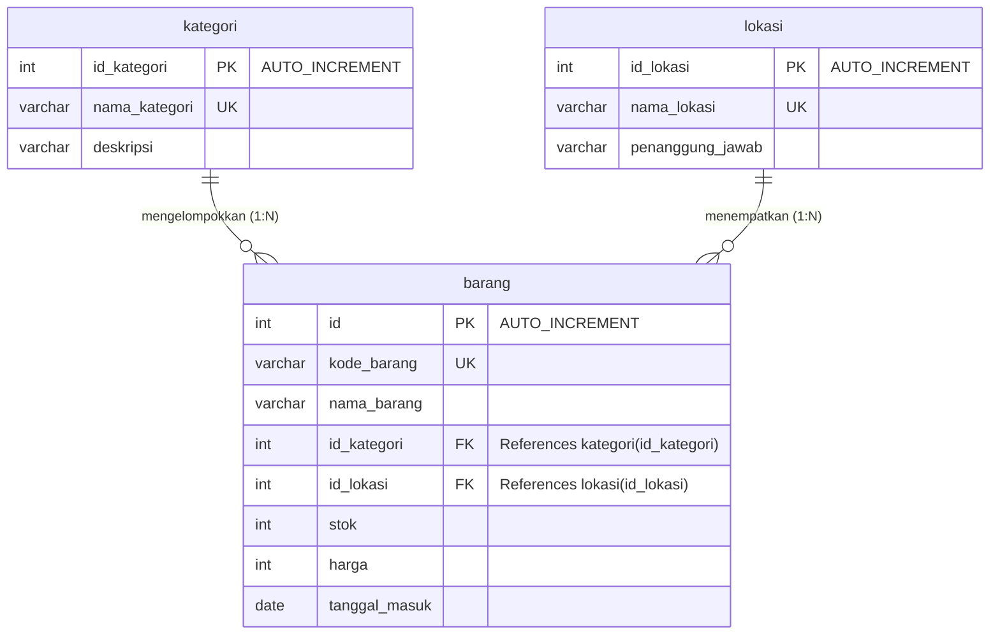

# Sistem Inventaris Barang (CRUD PHP Native, MySQL PDO & Normalisasi 3NF)

Aplikasi web CRUD (Create, Read, Update, Delete) sederhana, terstruktur, dan modern untuk pendataan dan manajemen inventaris barang. Dibangun menggunakan **PHP Native**, **MySQL**, **HTML5**, **CSS3 murni (tanpa framework eksternal)**, dan koneksi database **PDO (PHP Data Objects)** dengan arsitektur database terelasi yang telah dinormalisasi hingga **Third Normal Form (3NF)**.

---

## 📋 Fitur Utama
- **Read (Tampil Data Berelasi & Statistik)**: Menampilkan seluruh inventaris barang menggunakan query **SQL INNER JOIN** dari 3 tabel berelasi (tabel utama `barang`, tabel master `kategori`, dan tabel master `lokasi`), dilengkapi ringkasan statistik (total jenis barang, total stok unit, dan estimasi nilai aset).
- **Create (Tambah Barang Berelasi)**: Formulir penambahan barang dengan dropdown `<select>` dinamis yang memuat data master dari database serta validasi input wajib di sisi klien dan server.
- **Update (Edit Barang Berelasi)**: Form pembaruan data yang otomatis memilih (*pre-selected*) opsi kategori dan lokasi sesuai data lama.
- **Delete (Hapus Barang)**: Menghapus data barang dengan aman disertai konfirmasi JavaScript dan penanganan error *foreign key restriction*.
- **Keamanan Terjamin**:
  - Seluruh query input/parameter menggunakan **PDO Prepared Statements** (anti *SQL Injection*).
  - Sanitasi `htmlspecialchars()` pada seluruh output HTML (anti *Cross-Site Scripting / XSS*).
- **Notifikasi Status**: Pesan alert interaktif untuk setiap operasi (tambah, edit, hapus, maupun validasi gagal).

---

## 📁 Struktur Folder & File
```text
ukl/
│
├── config/
│   └── koneksi.php       # Konfigurasi koneksi MySQL dengan PDO & try-catch
├── assets/
│   └── css/
│       └── style.css     # Styling antarmuka modern, bersih, dan responsif
├── index.php             # Halaman utama dengan INNER JOIN 3 tabel & kartu statistik
├── tambah.php            # Form dan proses penambahan barang (dropdown dinamis master)
├── edit.php              # Form dan proses pembaruan barang (auto-selected dropdown)
├── hapus.php             # Skrip proses penghapusan barang berdasarkan ID
├── database.sql          # Skrip SQL struktur 3 tabel (3NF), relasi FK, dan data contoh
└── README.md             # Dokumentasi lengkap petunjuk penggunaan & arsitektur 3NF
```

---

## 🗄️ Struktur Database & Relasi Antar Tabel (PK & FK)

Sistem menggunakan 3 tabel yang saling terhubung melalui relasi relasional:



### 1. Tabel Master: `kategori`
Menyimpan referensi klasifikasi kelompok barang.
- `id_kategori` (`INT AUTO_INCREMENT`): **Primary Key**
- `nama_kategori` (`VARCHAR(50)`): Nama kategori unik (misal: Elektronik, ATK, Furnitur)
- `deskripsi` (`VARCHAR(255)`): Keterangan singkat mengenai kategori

### 2. Tabel Master: `lokasi`
Menyimpan referensi ruang atau gedung tempat fisik barang disimpan.
- `id_lokasi` (`INT AUTO_INCREMENT`): **Primary Key**
- `nama_lokasi` (`VARCHAR(50)`): Nama ruangan/gudang unik (misal: Gudang Utama, Lab Komputer 1)
- `penanggung_jawab` (`VARCHAR(100)`): Nama staf penanggung jawab ruangan

### 3. Tabel Utama: `barang`
Menyimpan entitas aset barang yang terikat pada master kategori dan lokasi.
- `id` (`INT AUTO_INCREMENT`): **Primary Key**
- `kode_barang` (`VARCHAR(20)`): Kode unik barang (misal: `BRG-001`)
- `nama_barang` (`VARCHAR(100)`): Nama lengkap barang
- `id_kategori` (`INT`): **Foreign Key** yang merujuk ke `kategori(id_kategori)`
- `id_lokasi` (`INT`): **Foreign Key** yang merujuk ke `lokasi(id_lokasi)`
- `stok` (`INT`): Kuantitas stok fisik
- `harga` (`INT`): Harga satuan per unit (Rupiah)
- `tanggal_masuk` (`DATE`): Tanggal pencatatan

### Aturan Constraint Foreign Key
- **`ON UPDATE CASCADE`**: Jika ID master pada tabel `kategori` atau `lokasi` diperbarui, ID referensi pada tabel `barang` otomatis ikut diperbarui.
- **`ON DELETE RESTRICT`**: Mencegah penghapusan baris kategori atau lokasi master selama masih ada data barang yang merujuk padanya (menjaga integritas referensial data).

---

## 📐 Penerapan Normalisasi Database Hingga 3NF

Database ini dirancang melalui tahapan normalisasi untuk mengeliminasi redundansi data serta anomali insert, update, dan delete:

1. **Bentuk Normal Pertama (1NF - First Normal Form)**:
   - Setiap kolom hanya berisi nilai tunggal bersifat **atomik** (tidak ada *multi-valued attributes* atau daftar koma dalam satu kolom).
   - Setiap baris memiliki identitas unik berupa **Primary Key** (`id`, `id_kategori`, `id_lokasi`).
   - Tidak ada kelompok kolom yang berulang (*repeating groups*).

2. **Bentuk Normal Kedua (2NF - Second Normal Form)**:
   - Memenuhi seluruh syarat 1NF.
   - Menghilangkan ketergantungan parsial (*partial functional dependency*). Karena primary key masing-masing tabel adalah *single column key* (`id`), seluruh atribut non-key (seperti `nama_barang`, `stok`, `harga`) bergantung penuh secara fungsional pada primary key tersebut.

3. **Bentuk Normal Ketiga (3NF - Third Normal Form)**:
   - Memenuhi seluruh syarat 2NF.
   - Menghilangkan ketergantungan transitif (*transitive functional dependency*), di mana atribut non-key tidak boleh bergantung pada atribut non-key lainnya.
   - **Penerapan Kasus**: Pada tabel `barang` awal yang belum ternormalisasi, nama kategori dan informasi lokasi (seperti penanggung jawab) tersimpan berulang di setiap baris barang. Jika ruangan memiliki penanggung jawab tertentu, penanggung jawab tersebut sebenarnya bergantung pada ruangan, bukan langsung pada barang. Oleh karena itu, atribut kelompok kategori dipecah ke master tabel `kategori`, dan atribut lokasi beserta penanggung jawab dipecah ke master tabel `lokasi`. Tabel `barang` hanya menyimpan pointer berupa **Foreign Key** (`id_kategori` dan `id_lokasi`).

---

## 🔍 Cara Kerja Query SQL INNER JOIN pada Aplikasi

Untuk menyajikan data yang mudah dibaca oleh pengguna (menampilkan teks nama kategori dan lokasi, bukan angka ID mentah), halaman `index.php` menggunakan query **`INNER JOIN`**:

```sql
SELECT 
    b.id,
    b.kode_barang,
    b.nama_barang,
    b.stok,
    b.harga,
    b.tanggal_masuk,
    k.nama_kategori,
    l.nama_lokasi,
    l.penanggung_jawab
FROM barang b
INNER JOIN kategori k ON b.id_kategori = k.id_kategori
INNER JOIN lokasi l ON b.id_lokasi = l.id_lokasi
ORDER BY b.id DESC;
```

### Mekanisme Kerja:
1. **`FROM barang b`**: Menjadikan tabel utama `barang` sebagai tabel acuan baris data inventaris.
2. **`INNER JOIN kategori k ON b.id_kategori = k.id_kategori`**: Mencocokkan nilai foreign key `b.id_kategori` dengan primary key `k.id_kategori`. Hasilnya, atribut `k.nama_kategori` ditarik dan disatukan ke dalam baris hasil query.
3. **`INNER JOIN lokasi l ON b.id_lokasi = l.id_lokasi`**: Mencocokkan nilai foreign key `b.id_lokasi` dengan primary key `l.id_lokasi`. Hasilnya, atribut `l.nama_lokasi` dan `l.penanggung_jawab` ditarik ke dalam baris hasil query.
4. **Efisiensi Memori & Penyimpanan**: Database hanya menyimpan angka integer ID berukuran kecil (4 byte) di tabel transaksi, namun antarmuka tetap menampilkan data teks informatif yang lengkap dan konsisten.

---

## 💻 Kebutuhan Sistem
1. **Web Server**: Apache (XAMPP / Laragon / WampServer)
2. **PHP**: Versi 7.4 atau PHP 8.x (dengan ekstensi `pdo_mysql` aktif)
3. **Database**: MySQL 5.7+ atau MariaDB 10.3+
4. **Web Browser**: Google Chrome, Mozilla Firefox, Microsoft Edge, Safari

---

## 🚀 Langkah-Langkah Menjalankan di Localhost

### 1. Letakkan Folder Project
Pastikan folder `ukl` berada di dalam direktori `htdocs` server web lokal Anda:
- **XAMPP**: `C:\xampp\htdocs\ukl`
- **Laragon**: `C:\laragon\www\ukl`

### 2. Nyalakan Apache & MySQL
Buka aplikasi **XAMPP Control Panel**, lalu klik tombol **Start** pada modul **Apache** dan **MySQL**.

### 3. Impor Database
1. Buka browser dan akses [http://localhost/phpmyadmin](http://localhost/phpmyadmin).
2. Buat database baru bernama `db_inventaris` (atau langsung ke tab **Import**).
3. Klik tab **Import** / **Impor**.
4. Klik tombol **Choose File** dan pilih file `database.sql` yang ada di folder project `ukl/database.sql`.
5. Klik tombol **Go** / **Kirim** di bagian bawah untuk mengeksekusi impor.

### 4. Konfigurasi Koneksi (Jika Berbeda)
Jika Anda menggunakan username/password MySQL yang berbeda, sesuaikan di file `config/koneksi.php`:
```php
$host     = 'localhost';
$dbname   = 'db_inventaris';
$username = 'root'; // default xampp: root
$password = '';     // default xampp: kosong
```

### 5. Akses Website
Buka browser dan kunjungi URL berikut:
```text
http://localhost/ukl/
```
Aplikasi siap didemonstrasikan!
